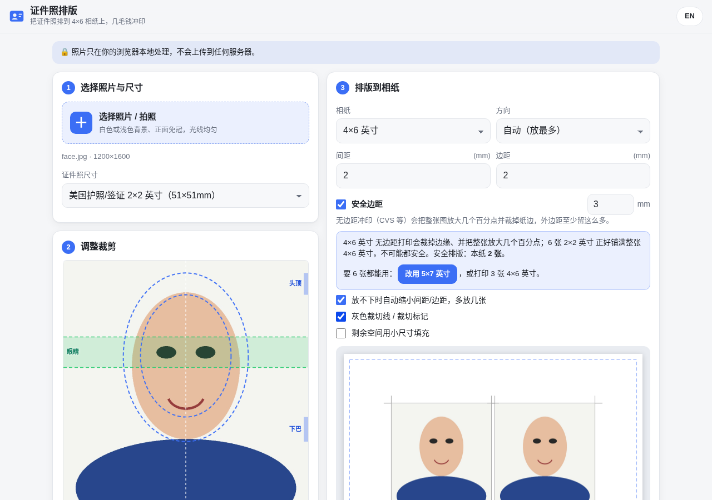

# 证件照排版 · ID Photo Print

**在线使用：<https://lfkdsk.github.io/id-photo-print/>**

把护照 / 签证证件照排到一张 4×6 英寸相纸上，拿去 CVS / Walgreens 冲印只要几毛钱（约 $0.3–0.5），不用花 $16.99 买店里的 Passport Photo。



## 功能

- **纯本地处理**：照片只在浏览器里处理，不会上传到任何服务器；无依赖、无构建、无 CDN。
- **常用尺寸**：美国护照/签证 2×2 英寸（默认）、中国护照/签证 33×48mm、一寸 25×35mm、二寸 35×49mm、申根/英国/欧盟 35×45mm、日本 35×45mm、加拿大 50×70mm，以及自定义（mm / inch）。
- **裁剪编辑**：拖动平移，双指 / 滚轮缩放，缩放滑块，±15° 旋转微调；自动按 EXIF 方向摆正 iPhone 照片。
- **参考线**：美国 2×2 显示眼睛高度带（距底边 1⅛″–1⅜″）和头部大小范围（下巴到头顶 1″–1⅜″）；其它尺寸显示中线和头部椭圆。可隐藏。
- **自动排版**：4×6（默认）、5×7、A6 相纸，300 DPI 输出（4×6 → 1800×1200 px，5×7 → 2100×1500 px）。自动尝试横竖两种方向取能放最多的方案；可调间距、边距，放不下时自动收紧（但不会突破安全边距）。可选灰色裁切线。
- **安全边距**（默认开，3 mm，可改 0–8 mm）：外边距永远不小于它。美国 2×2 在 4×6 上默认 **2 张**，在 5×7 上 **6 张**。安全排版比「铺满」少时会给出提示和一键「改用 5×7」按钮；关闭安全边距可回到铺满排法（4×6 上 6 张），并显示裁边警告。
- **打印校准**：填入印出来实际量到的照片边长，按「标准 ÷ 实测」把照片和间距缩小（限制在 −15% ~ +5%），抵消无边距冲印的放大；每种相纸分别记在浏览器 localStorage 里，可一键清除。
- **混排**（可选）：用一寸等小尺寸填满剩余空间。
- **导出**：JPEG（质量 0.95），文件头写入 300 DPI，文件名如 `id-photo-2x2-on-4x6.jpg`；iPhone 上可长按结果图「存储到照片」，或使用系统分享。
- **中英双语**，跟随系统深色 / 浅色模式。

## 为什么默认只排 2 张：无边距冲印会裁边、会放大

CVS / Walgreens 的 4×6 是**无边距**冲印：机器把整张图放大几个百分点，超出纸边的部分直接裁掉。实测把 6 张 2×2 铺满 4×6 去印，外圈照片被裁掉一条，中间的照片也比 2 英寸大。6 张 2×2 正好铺满 6×4 英寸，所以**一张 4×6 上不可能有 6 张都完整可用**。

- 默认开启 3 mm 安全边距，美国 2×2 在 4×6 上排 2 张。美国护照申请（DS-11 / DS-82）只需要 **1 张**照片，2 张已经够用、还多一张备用。
- 需要 6 张能用的：改用 **5×7**（安全排 6 张，页面上可一键切换），或者打印 **3 张 4×6**。
- 各尺寸安全排版张数（4×6 / 5×7，默认间距 2 mm、安全边距 3 mm）：美国 2×2 2 / 6，中国 33×48mm 6 / 10，一寸 12 / 18，二寸 4 / 9，申根/英国/欧盟、日本 35×45mm 8 / 9，加拿大 50×70mm 2 / 4。

## 冲印步骤（CVS）

1. 导出 JPEG，iPhone 上存到相册。
2. CVS Photo 网站或 App → Prints → 选择和排版一致的尺寸（**4×6** 或 **5×7**），上传。
3. **关闭**自动裁剪 / 自动增强 / Fit 等选项，保证比例不变。亚光、亮面都行。
4. 取件后**一定用尺子量**：每张应正好 2 英寸（50.8 mm）。沿灰线剪开。Walgreens / Costco / Walmart 同理。

## 打印校准

无边距冲印的放大比例因店、因机器、因相纸尺寸而不同，所以做成了可校准的：

1. 按默认设置打印一次；
2. 用尺子量一张**中间**、四边都没被裁到的照片的宽度，比如 52.3 mm；
3. 在「排版到相纸」里展开「打印校准」填入 52.3，照片和间距会按 50.8 ÷ 52.3 缩小（补偿 −2.9%，2×2 从 600 px 变成 583 px），外边距仍不小于安全边距；
4. 重新导出、打印，再量一次。校准值按相纸分别保存，换回未校准的相纸不受影响。

美国官方照片要求见 [travel.state.gov](https://travel.state.gov/content/travel/en/passports/how-apply/photos.html)。本工具只保证物理尺寸正确，不保证照片一定被接受。

## 本地运行 / 测试

```bash
python3 -m http.server 8000   # 打开 http://localhost:8000/
# 端到端测试（需要 Python Playwright + Chromium + Pillow）
python3 tests/make_test_images.py /tmp/idphoto-test
python3 tests/e2e.py http://localhost:8000/ /tmp/idphoto-test docs
```

---

## English

**Live: <https://lfkdsk.github.io/id-photo-print/>**

A static, fully client-side tool that tiles an ID / passport photo onto a 4×6 or 5×7 in print at 300 DPI, so you can print it at CVS / Walgreens / Costco / Walmart for well under a dollar instead of paying ~$17 for "passport photos". Your photo never leaves the browser. Presets for US, China, Schengen/UK/EU, Japan, Canada and Chinese 1-inch/2-inch sizes plus custom sizes; crop editor with US head/eye guides; 4×6, 5×7 and A6 paper; cut lines; optional mixed sizes; JPEG export with a 300 DPI JFIF header.

**Borderless printing.** Drugstore 4×6 prints are borderless: the whole image is enlarged a few percent and the overflow is cut off at the paper edges. Six 2×2 photos fill 6×4 in exactly, so six fully usable photos on one 4×6 is physically impossible — the outer ones get trimmed and the rest come out larger than 2 in. The tool therefore keeps a **3 mm safe margin** by default (editable 0–8 mm): US 2×2 gives **2 per 4×6** and **6 per 5×7**. When the safe layout holds fewer photos than edge-to-edge packing, a hint offers a one-click switch to 5×7 (or print three 4×6 sheets). A US passport application needs only 1 photo. Turning the safe margin off restores edge-to-edge packing with a trim warning.

**Print calibration.** Print once, measure a center (untrimmed) photo with a ruler, enter the number (e.g. 52.3 mm for a 2×2) and re-export: photos and gaps are scaled by expected ÷ measured (clamped to −15%…+5%) so they come out at true size after the printer's enlargement, while the outer margin stays ≥ the safe margin. Saved per paper size in localStorage. When ordering, pick the same print size as the layout, turn off auto-crop / enhance, and always check the result with a ruler. Acceptance by any authority is not guaranteed.

License: [MIT](LICENSE)
